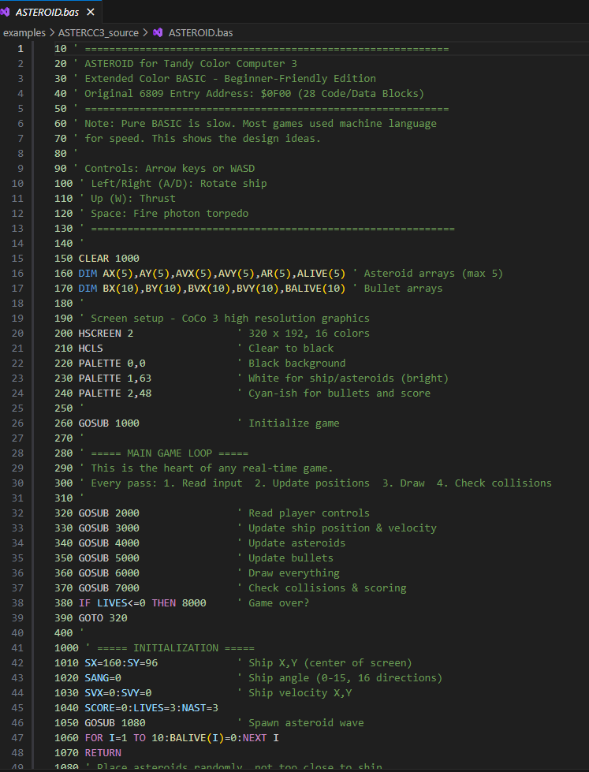
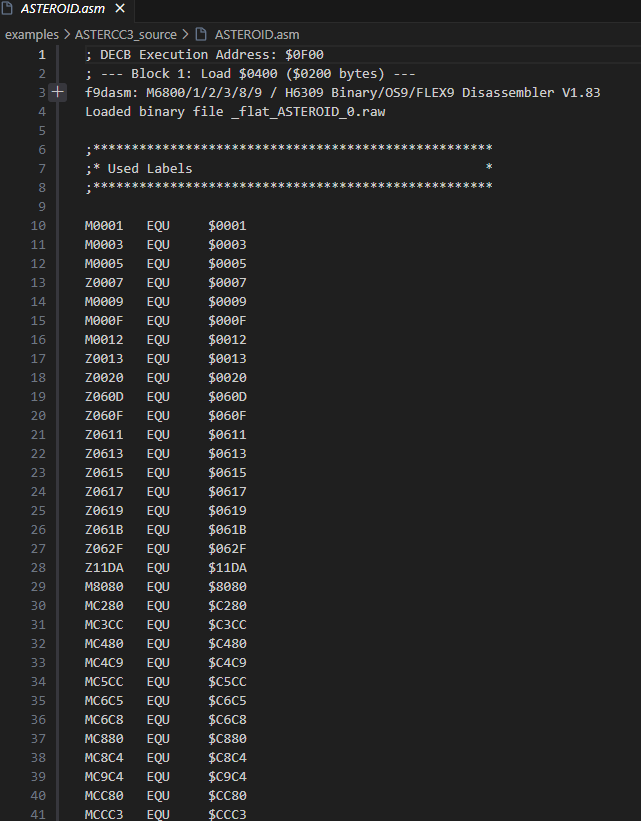

# CoCo Source Extractor

**CoCo Source Extractor** is a Windows tool that opens classic TRS-80 / Tandy Color Computer (CoCo 1/2/3) disk images, cartridges, cassettes, and binary files and turns them into clean, readable source code you can study, learn from, edit, and run.

**Note:** the created BASIC code is a brand-new recreation of the original program rather than a one-to-one copy, written in plain, beginner-friendly Super Extended Color BASIC 2.1 so new programmers can easily read how it works.

- **`.asm` (6809 Assembly)** — The original machine code extracted and disassembled using [`f9dasm`](https://github.com/Arakula/f9dasm) and [`decb` (ToolShed)](https://github.com/nitros9project/toolshed).
- **`.bas` (Super Extended Color BASIC 2.1)** — A complete, easy-to-read BASIC version of the program:
  - Written **one step per line** with clear comments explaining what each part does.
  - Uses standard CoCo 3 BASIC commands for screens, colors, shapes, text, keyboard input, and sound—no raw machine-code tricks or giant hex dumps.
  - Native BASIC programs already stored on a disk or tape are extracted directly and never overwritten.

---

## What It Does

When you open a CoCo file, the app creates a `<filename>_source` folder next to your file containing:

- **`.asm`** — The disassembled 6809 assembly listing for reference.
- **`.bas`** — A clean, commented Super Extended Color BASIC 2.1 version of the game or utility, designed for beginners to read and learn from.

### Supported File Types
- Disk Images (`.dsk`)
- Cartridge ROMs (`.ccc`, `.cco`, `.rom` — including compressed self-extracting cartridges)
- DECB Binaries & Cassette Images (`.bin`, `.cas`)
- Tokenized BASIC Programs (`.bas`)
- Existing Disassembled 6809 Files (`.asm`)

---

## How to Use

### GUI Mode
1. **Double-click `CoCoSourceExtractor.exe`** (or drag and drop a CoCo file onto it).
2. **Choose your CoCo file** in the file picker window.
3. **Wait a moment** while extraction and decompilation finish.
4. **Open the `<filename>_source` folder** created next to your original file to view the `.asm` and `.bas` files.

### CLI / Headless Batch Mode
Run from PowerShell or Command Prompt with `--cli` (or `--headless`):
```powershell
Start-Process -FilePath ".\CoCoSourceExtractor.exe" -ArgumentList @("--cli", "`"path\to\game.dsk`"") -Wait
```

### API Key Setup (Required for Creating `.bas` Files)
To read the `.asm` file and write a clean, beginner-friendly `.bas` program, the app uses an AI service (Anthropic Claude, Google Gemini, or xAI Grok).

Put your API key in a plain text file named `api_key.txt` in the same folder as `CoCoSourceExtractor.exe` (or set `ANTHROPIC_API_KEY`, `GEMINI_API_KEY`, `GOOGLE_API_KEY`, or `XAI_API_KEY` in your Windows environment variables). The app automatically detects which service your key belongs to.

---

## Screenshots

### Extracted Extended Color BASIC Source (`.bas`)


### Extracted 6809 Assembly Source (`.asm`)


---

## Necessary Tools

Keep these tools in the `CoCoSourceExtractor` root folder (the app checks both its own directory and parent directory automatically):
- **[f9dasm](https://github.com/Arakula/f9dasm)** (`f9dasm.exe`) — Motorola 6800/6809/6309 disassembler used to generate `.asm` source.
- **[decb (ToolShed)](https://github.com/nitros9project/toolshed)** (`decb.exe`) — Disk Extended Color BASIC utility used to inspect disks, extract files, and detokenize/tokenize BASIC programs.
- **`coco3.info`** — CoCo 3 hardware and ROM symbol definitions passed to `f9dasm`.

---

## Acquiring CoCo Files

Visit the [Color Computer Archive](https://www.colorcomputerarchive.com/) to browse CoCo 1/2/3 games, applications, and utilities. Extract `.zip` archives first before passing `.dsk`, `.ccc`, `.rom`, `.bin`, or `.cas` files to the extractor.

## Disclosure

Agentic AI was used to help write and test some of the code in this app.

## License

This project is released into the public domain under the [UNLICENSE](UNLICENSE).
